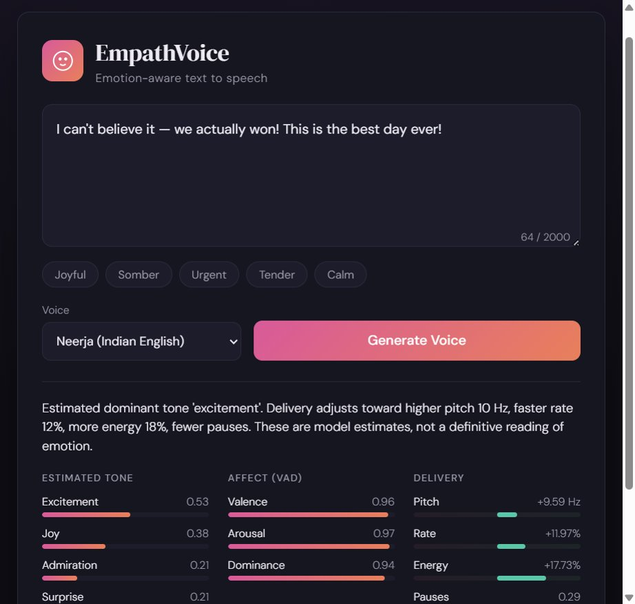
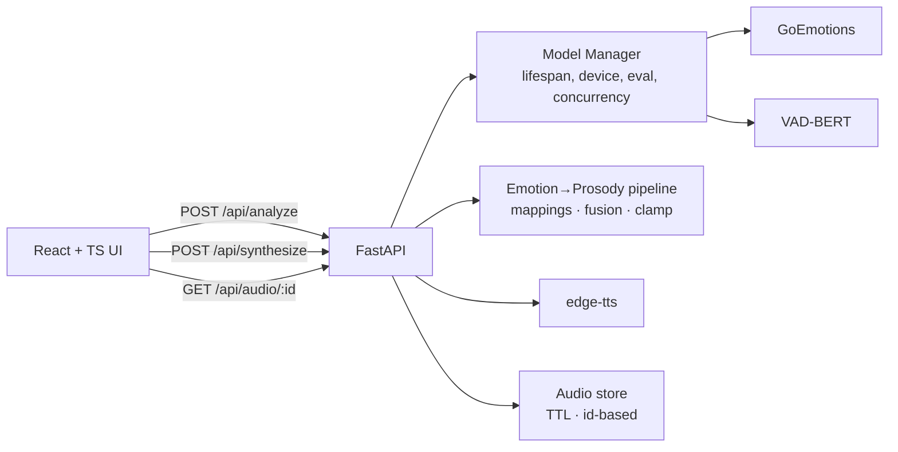

# EmpathVoice

Emotion-aware text-to-speech with a transparent prosody pipeline.

[](https://huggingface.co/spaces)
[](https://www.python.org/downloads/)
[](https://react.dev/)
[](https://fastapi.tiangolo.com/)

EmpathVoice reads a piece of text, estimates its emotional character with two
complementary models, maps that estimate to concrete speech-delivery parameters
(pitch, rate, energy, pauses), and synthesizes audio whose delivery reflects the
text. The thing I care about most here is **transparency**: instead of a
black-box "expressive TTS", the app shows you *why* it chose a particular
delivery, directly from the model outputs.

> The emotion and VAD numbers are **model estimates**, not calibrated
> probabilities or a definitive reading of anyone's feelings. The UI and the API
> describe them that way on purpose.

---

## Preview

<p align="center">
  
</p>

---

## Motivation

Most expressive-TTS demos hide their reasoning: text goes in, "emotional" audio
comes out, and you can't tell what the system thought the text meant. I wanted
the opposite — a small, honest studio where the emotion analysis is explicit,
interpretable, and visibly drives the voice. The analysis pipeline is
deterministic and inspectable, which makes it easy to reason about, debug, and
explain.

## Features

- **Live emotion analysis preview** — as you type, the app shows the estimated
  emotions, the valence/arousal/dominance (VAD) estimate, and the resulting
  pitch/rate/energy/pause adjustments, all computed by the backend.
- **One-click synthesis** — generate speech that applies those parameters, then
  play, replay, and download the result.
- **Voice selection** — a set of English edge-tts voices.
- **Transparent delivery** — every number shown comes from the real pipeline;
  there is no client-side keyword guessing.
- **Clean failure and warm-up handling** — the UI reports when models are still
  loading or unavailable, and the API returns structured errors.

## Architecture



The backend is organized by responsibility: HTTP/API layer, request/response
schemas, configuration, model lifecycle, the emotion→prosody pipeline, TTS, and
audio storage are each isolated. A fuller write-up — request lifecycle, the
model-readiness model, the fusion math, and the main design decisions — is in
[`docs/architecture.md`](docs/architecture.md).

## The AI pipeline

The core is a deterministic, interpretable **hybrid emotion-to-prosody
controller**. Two views of the text's emotion are combined:

1. **Discrete branch** — `SamLowe/roberta-base-go_emotions` produces a
   28-dimensional multi-label score vector. A handcrafted 28×4 weight matrix maps
   those labels to a prosody shift `[pitch, rate, energy, pauses]`. The matrix is
   aligned to the model's labels *by name*, so it stays correct regardless of
   label ordering.
2. **Continuous branch** — `RobroKools/vad-bert` estimates valence, arousal, and
   dominance in `[0, 1]`. These are centered to `[-1, 1]`, passed through a
   `tanh` nonlinearity, and mapped to the same prosody space by a 4×3 matrix.

The two shifts are combined with a **confidence-adaptive fusion**: the top
*non-neutral* discrete score sets how much the categorical branch is trusted
versus the smoother VAD branch, per prosody dimension. (Excluding `neutral` from
the confidence term is a deliberate fix — otherwise neutral text, whose discrete
prosody row is all zeros, would suppress the VAD branch and flatten delivery.)

The fused vector is scaled and **clamped** to safe TTS ranges, then applied via
edge-tts (pitch in Hz, rate and volume in percent). Because edge-tts does not
expose SSML `<break>` control, pauses are approximated by inserting commas at
clause boundaries, scaled by the pause level.

**Honesty note:** the weight matrices and clamps are hand-tuned heuristics, not
learned or formally evaluated. I make no claims about emotion-recognition
accuracy or "emotional quality"; the value here is interpretability and a clean,
controllable mapping, not state-of-the-art affect modeling.

## Tech stack

- **Backend:** Python 3.10+, FastAPI, Pydantic v2, PyTorch, Hugging Face
  Transformers, NumPy, edge-tts.
- **Frontend:** React 18, TypeScript, Vite.
- **Testing:** pytest (unit + API with fakes; optional integration tests).

## Project structure

```text
EmpathVoice/
├── app/
│   ├── main.py              # app factory, lifespan, routing, SPA serving
│   ├── core/                # config, logging, error handling
│   ├── schemas.py           # Pydantic request/response contracts
│   ├── ml/                  # model wrappers + lifecycle manager
│   ├── emotion/             # weights, VAD mapping, fusion, prosody, pipeline
│   ├── tts/                 # pause injection, synthesizer, voices
│   ├── audio/               # TTL audio store
│   └── api/                 # one module per route group
├── frontend/                # React + TypeScript + Vite app
├── tests/                   # unit, API, and optional integration tests
├── docs/architecture.md
├── requirements.txt / requirements-dev.txt
└── run.py
```

## Setup

### Backend

```bash
cd EmpathVoice
python -m venv .venv && source .venv/bin/activate   # Windows: .venv\Scripts\activate
pip install -r requirements.txt
```

PyTorch and Transformers download the pretrained models on first use (a few
hundred MB). CUDA is used automatically when available; otherwise it runs on CPU.

### Frontend

```bash
cd frontend
npm install
```

## Environment configuration

All settings have defaults, so no configuration is required. To override, copy
`.env.example` to `.env`. Variables use the `EMPATHVOICE_` prefix — model names,
`DEVICE` (auto-detected if unset), `INFERENCE_CONCURRENCY`, `AUDIO_TTL_SECONDS`
(default 3600), `DEFAULT_VOICE`, `MAX_TEXT_CHARS`, and `LOG_LEVEL`.

## Running

### Development (two processes, hot reload)

```bash
# Terminal 1 — backend on :8000
python run.py

# Terminal 2 — frontend on :5173 (proxies /api and probes to :8000)
cd frontend && npm run dev
```

Open http://127.0.0.1:5173.

### Production-style (single process)

Build the frontend; FastAPI then serves it from `frontend/dist` at `/`:

```bash
cd frontend && npm run build && cd ..
uvicorn app.main:app --host 0.0.0.0 --port 8000   # no --reload: models load once
```

Open http://127.0.0.1:8000. If the frontend isn't built, `/` redirects to the
interactive API docs at `/docs`.

### Docker (Local)

Run the entire application in a self-contained container:

```bash
docker build -t empathvoice .
docker run -p 7860:7860 empathvoice
```

Open http://127.0.0.1:7860.

---

## Deployment & Live Demo

Because EmpathVoice runs two PyTorch transformer models in memory (`RoBERTa-GoEmotions` and `VAD-BERT`), it requires at least ~1.5 GB of RAM.

### Deploying to Hugging Face Spaces (100% Free Tier via Gradio SDK)

Hugging Face Spaces allows you to host an interactive demo of EmpathVoice for free:

1. **Create a Space**: Go to [huggingface.co/new-space](https://huggingface.co/new-space).
2. **Select Space SDK**: Choose **Gradio** (which is 100% free with no credit card required).
3. **Space Hardware**: Select the **Free** tier (CPU Basic or ZeroGPU).
4. **Deploy**:
   - Push this repository directly to your Space's Git remote:
     ```bash
     git remote add space https://huggingface.co/spaces/<your-username>/<space-name>
     git push space main
     ```
   - *Or* link your GitHub repository in Space Settings for automated deployments.
5. Hugging Face automatically reads the YAML frontmatter in this `README.md`, installs `requirements.txt`, and runs **`app.py`** to serve your live demo at `https://huggingface.co/spaces/<your-username>/<space-name>`.

### Containerized Deployment (Railway / Render / Docker)

The repository also includes a production-ready **`Dockerfile`** that builds both the React frontend and FastAPI backend into a single container:

* **Local Docker**:
  ```bash
  docker build -t empathvoice .
  docker run -p 7860:7860 empathvoice
  ```
* **Railway**: Connect your GitHub repo; Railway automatically detects the `Dockerfile` and deploys both backend and React frontend.
* **Render**: Deploy as a Web Service. Select the **Starter tier (2 GB RAM)** since the free tier (512 MB) will run out of memory when loading PyTorch models.

---

## API

Interactive docs live at `/docs`. Summary:

| Method | Path                 | Purpose                                             |
| ------ | -------------------- | --------------------------------------------------- |
| GET    | `/health`            | Liveness — process is up (always 200).              |
| GET    | `/ready`             | Readiness — 200 when models are loaded, else 503.   |
| POST   | `/api/analyze`       | Emotion → prosody analysis (no audio).              |
| POST   | `/api/synthesize`    | Analysis + synthesized audio.                       |
| GET    | `/api/audio/{id}`    | Retrieve generated audio by id (expires via TTL).   |
| GET    | `/api/voices`        | Available voices + default.                         |

Examples:

```bash
curl -s -X POST http://127.0.0.1:8000/api/analyze \
  -H 'Content-Type: application/json' \
  -d '{"text": "I am so proud of you!"}'

curl -s -X POST http://127.0.0.1:8000/api/synthesize \
  -H 'Content-Type: application/json' \
  -d '{"text": "I am so proud of you!", "voice": "en-US-AriaNeural"}'
# -> { "audio_id": "...", "audio_url": "/api/audio/...", "expires_in_seconds": 3600, "analysis": {...} }
```

Errors are returned as `{"error": {"code", "message"}}` with an appropriate
status code (e.g. `model_not_ready` → 503, `invalid_request` → 400,
`audio_not_found` → 404). Input validation errors use FastAPI's 422.

## Testing

```bash
pip install -r requirements-dev.txt

pytest                 # unit + API tests (fakes; no downloads, no network)
pytest -m integration  # optional: loads real models + calls edge-tts
```

The default suite mocks the models and the TTS service, so it is fast and
hermetic. The integration tests exercise the real inference and synthesis paths
and skip cleanly when torch / edge-tts are unavailable.

## Known limitations

- Prosody mappings and clamps are hand-tuned heuristics; there is no learned
  prosody model and no formal evaluation of emotional fidelity.
- A single prosody setting is applied to the whole input — long, mixed-emotion
  passages are not segmented per sentence.
- Pause control is approximate (comma insertion), because edge-tts does not
  expose SSML break timing.
- Synthesis depends on the external edge-tts (Microsoft) service and needs
  network access; voice quality is whatever that service provides.
- Generated audio is intentionally temporary (1-hour TTL) and not persisted
  across restarts.

## Possible future improvements

- Per-sentence prosody for mixed-emotion passages (multi-segment synthesis).
- An expressiveness control (the backend already accepts a global strength
  parameter; it is intentionally not exposed in the current UI).
- A pluggable TTS backend that supports true SSML prosody/break control.
- Calibration of the emotion scores if a labelled dataset is introduced.
